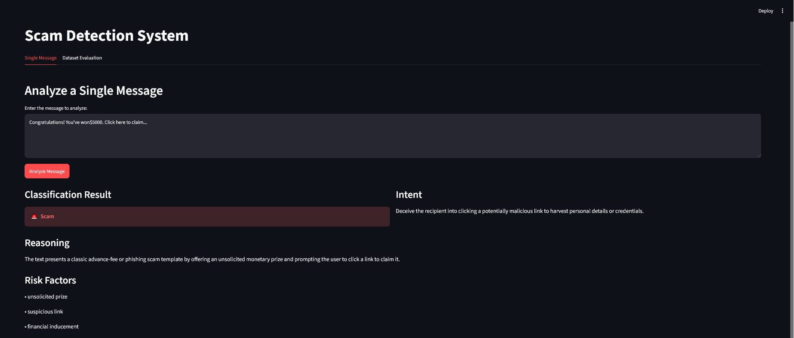
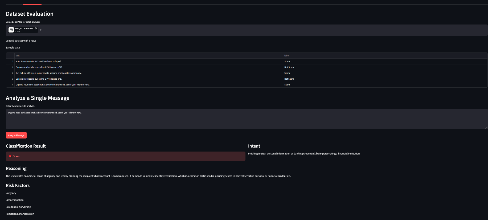

# 🛡️ ScamGuard AI

An AI-powered scam and phishing message detector that uses the **Gemini LLM** with a **ReAct (Reasoning + Acting) prompting strategy** to classify text messages as *Scam*, *Not Scam*, or *Uncertain* — complete with reasoning, intent detection, and risk-factor explainability. Built with a modular Python pipeline and an interactive **Streamlit** web app for both single-message and batch (dataset) analysis.

---

## 📌 Project Overview

Scam and phishing messages (SMS, email, chat) are a growing threat, and most users have no quick way to verify whether a message they received is malicious. **ScamGuard AI** tackles this problem by using a Large Language Model as a reasoning engine: instead of a simple black-box classification, the system walks through an explicit *Thought → Action → Observation → Final Answer* reasoning chain before returning a structured verdict.

This makes the tool not just a classifier, but an **explainable scam-detection assistant** — showing *why* a message was flagged, what the likely intent behind it was, and which specific risk factors (urgency, impersonation, financial requests, etc.) were present.

The project is built as a clean, extensible pipeline (prompt builder → LLM executor → output parser) wrapped in a simple Streamlit UI, making it easy to test a single message interactively or evaluate an entire CSV dataset of messages in bulk.

---

## ✨ Key Features

- **🔍 Scam Classification** — Labels any input message as `Scam`, `Not Scam`, or `Uncertain`.
- **🧠 ReAct-based Reasoning** — Uses a structured *Thought → Action → Observation → Final Answer* prompting strategy so the model reasons step-by-step instead of guessing.
- **🎯 Intent Detection** — Surfaces the likely intent behind a message (e.g., phishing for credentials, requesting money, impersonating an organization).
- **⚠️ Risk Factor Explainability** — Highlights concrete red flags such as urgency tactics, suspicious links, poor grammar, or emotional manipulation.
- **📊 Structured JSON Output** — Every detection returns a clean, structured JSON object, making it easy to log, store, or integrate downstream.
- **📁 Batch / Dataset Evaluation** — Upload a CSV of messages and run the detector across multiple rows at once, with automatic summary charts.
- **🖥️ Interactive Web UI** — A Streamlit app for analyzing single messages or full datasets, with color-coded results (✅ Not Scam / 🚨 Scam / ⚠️ Uncertain).
- **🔁 Resilient LLM Calls** — Built-in retry logic with exponential backoff for handling transient API failures gracefully.
- **🧩 Modular Pipeline Design** — Prompt building, LLM execution, and output parsing are cleanly separated for easy maintenance and extension (e.g., adding new prompting strategies).
- **📝 Logging** — Every stage of the pipeline is logged for easier debugging and observability.

---

## 🛠️ Tech Stack

| Category              | Technology                           |
|-----------------------|--------------------------------------|
| Language              | Python 3.12                          |
| LLM Provider          | Google Gemini API (`google-genai`)   |
| Web Interface         | Streamlit                            |
| Data Handling         | pandas                               |
| Validation            | Pydantic                             |
| Environment Config    | python-dotenv                        |
| Progress / Utilities  | tqdm                                 |

---

## 📂 Folder Structure

```
ScamGuard-AI/
├── main.py                      # CLI entry point for testing detection
├── config.py                    # Environment & model configuration
├── utils.py                     # Logging, JSON extraction, file loading helpers
├── evaluate.py                  # (Reserved for dataset evaluation scripts)
├── requirements.txt             # Python dependencies
│
├── llm/                         # LLM client & prompt management
│   ├── client.py                 # Gemini API client with retry logic
│   ├── prompts.py                # Prompt loading/generation logic
│   └── prompts/
│       ├── react.md               # ReAct-style reasoning prompt template
│       └── few_shot.md            # Few-shot prompt template (extensible)
│
├── pipeline/
│   └── scam_detector/
│       ├── builder.py             # Builds the final prompt based on strategy
│       ├── executor.py            # Executes the LLM call
│       ├── parser.py              # Parses raw LLM output into structured JSON
│       └── detector.py            # Orchestrates the end-to-end detection pipeline
│
└── streamlit/
    └── app.py                    # Streamlit web application (UI)
```

---

## ⚙️ Setup Instructions

### 1. Clone the repository

```bash
git clone https://github.com/<your-username>/ScamGuard-AI.git
cd ScamGuard-AI
```

### 2. Create and activate a virtual environment

```bash
python -m venv venv
source venv/bin/activate      # On Windows: venv\Scripts\activate
```

### 3. Install dependencies

```bash
pip install -r requirements.txt
```

### 4. Configure environment variables

Create a `.env` file in the project root (this file is **git-ignored** and should never be committed):

```
GEMINI_API_KEY=your_gemini_api_key_here
```

> Get a free Gemini API key from [Google AI Studio](https://aistudio.google.com/).

### 5. Run the app

**Option A — Streamlit Web UI (recommended):**

```bash
streamlit run streamlit/app.py
```

Then open the local URL shown in your terminal (usually `http://localhost:8501`).

**Option B — Command Line:**

```bash
python main.py
```

You'll be prompted to enter a message directly in the terminal.

---

## 🎬 Demo

> _Add screenshots or a GIF of the Streamlit app here, e.g.:_
>
> 
> 

**Example — Single Message Analysis:**

**Input:**
```
Congratulations! You've won $1000. Click here to claim your prize now before it expires!
```

**Output:**
```json
{
  "label": "Scam",
  "reasoning": "The message uses urgency ('before it expires'), an unrealistic reward, and a suspicious call-to-action link, all common scam patterns.",
  "intent": "Lure the user into clicking a malicious link to steal personal/financial information",
  "risk_factors": ["urgency", "unsolicited prize", "suspicious link", "emotional manipulation"]
}
```

---

## 🔐 Security Note

This project requires a Gemini API key to function. **API keys are never hardcoded** — they are loaded securely from a local `.env` file via `python-dotenv` and excluded from version control using `.gitignore`. Do not commit your `.env` file or expose your API key publicly.

---

## 🚀 Future Improvements

- Add few-shot prompting strategy as a selectable alternative to ReAct
- Support additional LLM providers (OpenAI, Claude, etc.)
- Add automated evaluation metrics (`evaluate.py`) against labeled scam datasets
- Deploy the Streamlit app to a public hosting service (e.g., Streamlit Community Cloud)

---

## 📄 License

This project is open source and available under the [MIT License](LICENSE).
